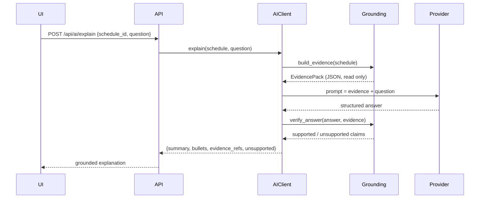

# AI subsystem

> The AI explains validated schedules. It never makes scheduling decisions.

---

## 1. What the AI is allowed to do

| Allowed | Not allowed |
| --- | --- |
| Summarise a validated plan in plain language. | Invent operations, machines or operators. |
| Explain *why* a metric looks the way it does. | Change or relax a hard constraint. |
| Recommend alternatives ("consider moving … to a later shift"). | Apply a change to the live plan. |
| Compare two validated plan versions. | Report a number that is not in the evidence. |

The mechanism is the **EvidencePack**: before the model is called, the backend
derives a JSON document from the *validated* schedule (operations, metrics,
validator report, comparison deltas). The prompt contains nothing else. After
the answer comes back, `verify_answer()` extracts every number from the reply
and checks it against the evidence. Numbers that cannot be traced back are
returned in the `unsupported` list and are shown to the user as such.



---

## 2. Provider kinds

The adapter interface is intentionally tiny, so a new provider is one class:

| Kind | Endpoint | Key required | Notes |
| --- | --- | --- | --- |
| `openai` | `https://api.openai.com/v1` | yes | Chat Completions API. |
| `anthropic` | `https://api.anthropic.com/v1` | yes | Messages API. |
| `openrouter` | `https://openrouter.ai/api/v1` | yes | OpenAI-compatible gateway. |
| `custom` | your own base URL | optional | Any OpenAI-compatible endpoint (gateways, proxies, self hosted). |
| `ollama` | `http://localhost:11434/v1` | no | Local models. The model list is discovered from the local server. |
| `mock` | – | no | Deterministic offline provider used by the tests and the demo. |

`GET /api/ai/catalog` returns this table with the default base URL, the
default model and the model list of every kind.

### Local models with Ollama

Ollama is the zero-cost, zero-credential option:

```bash
ollama serve
ollama pull gemma3:1b          # or llama3.1, qwen2.5, …
```

Add a provider of kind **Ollama (local)** with the base URL
`http://localhost:11434/v1` and the model name. *Discover models* queries the
server's `/api/tags` endpoint, so the list in the UI always shows the models
that are actually installed.

The platform asks for a JSON answer (`response_format: {"type": "json_object"}`)
and normalises whatever comes back into the documented schema. A small model
that ignores the schema still produces a readable answer, but the answer is
then flagged as `unsupported` because it was not produced in the agreed
structure.

**Live verification.** Against a local Ollama server the following were
executed successfully: model discovery, the connection test (≈ 60 ms) and a
full grounded explanation with `gemma3:1b` (2 051 prompt tokens → 93
completion tokens, ≈ 0.9 s) whose numeric claims were all verified against the
evidence pack. The hosted OpenAI, Anthropic and OpenRouter adapters were
**not** exercised against a live endpoint, because no paid credentials were
available; they are covered by the deterministic mock provider in the
automated tests.

---

## 3. Configuring a provider

### In the UI

**AI settings → Providers → Add provider**

1. Pick the provider kind.
2. Enter the base URL (pre-filled with the default for the kind).
3. Paste the API key — it is **write only**: the backend encrypts it and never
   returns it. The UI only shows a masked hint such as `sk-12…9f3a`.
4. Choose the model (or use *Discover models* to query the provider).
5. Press *Test connection*: the backend performs a minimal request and reports
   the latency or the concrete error.

### From the environment

The environment variables below are a convenience for seeding a provider; they
are **not** read by the scheduler.

```bash
# OpenAI
export OPENAI_API_KEY="sk-..."
export OPENAI_BASE_URL="https://api.openai.com/v1"
export OPENAI_MODEL="gpt-4o-mini"

# Anthropic
export ANTHROPIC_API_KEY="sk-ant-..."
export ANTHROPIC_MODEL="claude-3-5-haiku-latest"

# OpenRouter
export OPENROUTER_API_KEY="sk-or-..."
export OPENROUTER_BASE_URL="https://openrouter.ai/api/v1"

# Local Ollama
export OLLAMA_BASE_URL="http://localhost:11434/v1"
export OLLAMA_MODEL="gemma3:1b"

# Any OpenAI-compatible gateway
export CUSTOM_LLM_BASE_URL="https://my-gateway.internal/v1"
export CUSTOM_LLM_API_KEY="..."
export CUSTOM_LLM_MODEL="my-model"
```

---

## 4. A subscription is not API access

> **A ChatGPT, Claude or Gemini subscription does not include API access.**

The consumer subscriptions (chat apps) and the developer APIs are billed
separately:

| You have | You still need |
| --- | --- |
| A ChatGPT Plus/Pro subscription | An OpenAI **API** key with API billing enabled. |
| A Claude Pro/Max subscription | An Anthropic **API** key with console billing. |
| A Gemini subscription | A Google AI Studio / Vertex API key. |

The application therefore never assumes that a subscription unlocks the API.
The connectivity test in the AI settings screen is the only reliable way to
check: it performs a real request and reports the concrete HTTP error
(`401 invalid_api_key`, `429 rate_limit_exceeded`, `402 insufficient_quota`,
…).

---

## 5. Cost, limits and safety

| Setting | Environment variable | Meaning |
| --- | --- | --- |
| Enable / disable AI | `AI_ENABLED` | `false` disables the subsystem entirely. |
| Default provider | `AI_DEFAULT_PROVIDER` | Which provider is used when none is selected. |
| Request timeout | `AI_REQUEST_TIMEOUT_SECONDS` | Per request timeout (default 45 s). |
| Max tokens | `AI_MAX_TOKENS` | Response budget per request. |
| Retries | `AI_MAX_RETRIES` | Retries on timeouts and 5xx errors. |
| Monthly budget | `AI_MONTHLY_BUDGET_USD` | Soft budget per calendar month. |
| Spend limit | `AI_SPEND_LIMIT_USD` | Hard limit for a single request. |

* The backend estimates the cost of every call from the token counts and
  refuses to start a request that would exceed the budget (HTTP 402 with a
  clear message).
* API keys are encrypted at rest (AES-GCM, key derived from `SECRET_KEY`) and
  are never written to the log. The logging layer additionally redacts any
  field whose name contains `password`, `secret`, `api_key` or `token`.
* All traffic is issued **from the backend**. The browser never sees a
  provider key.

---

## 6. Offline mode

```bash
AI_ENABLED=false
AI_DEFAULT_PROVIDER=mock
```

With this configuration:

* the scheduler works exactly as before — the AI is not part of the decision
  path at all;
* the assistant answers from the deterministic `mock` provider, which only
  reformats the evidence pack (so the UI stays testable);
* no outbound network request is made.

The test suite runs entirely in this mode; the adapter tests for the hosted
providers use a mocked HTTP transport, so `pytest` never needs network access.

---

## 7. Extending the provider list

```python
# backend/app/ai/providers.py
class MyProvider:
    kind = "custom"

    def complete(self, config: ProviderConfig, prompt: str) -> CompletionResult:
        ...
```

1. Implement the protocol, register the kind in `PROVIDER_KINDS` and add an
   entry to `PROVIDER_DEFAULTS` (base URL, default model, model list).
2. Add adapter tests for success, timeout, HTTP error, invalid key and a
   malformed response.
3. Document the new kind in this file.
