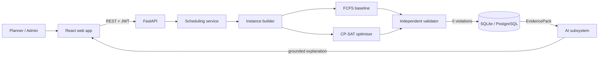
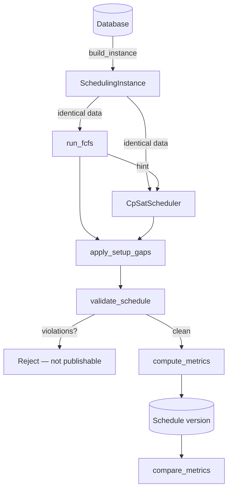
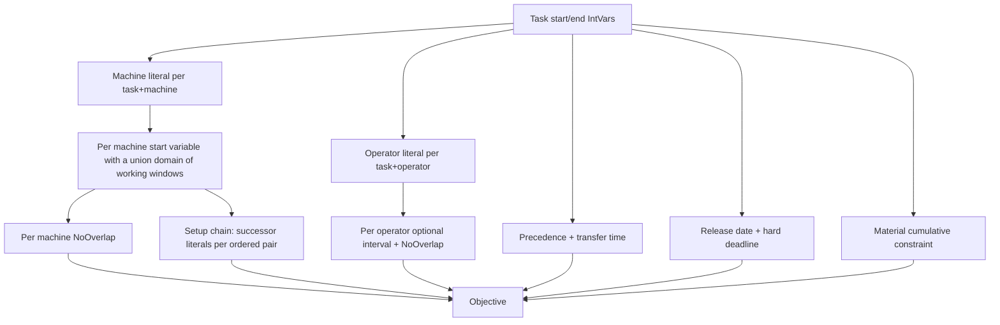
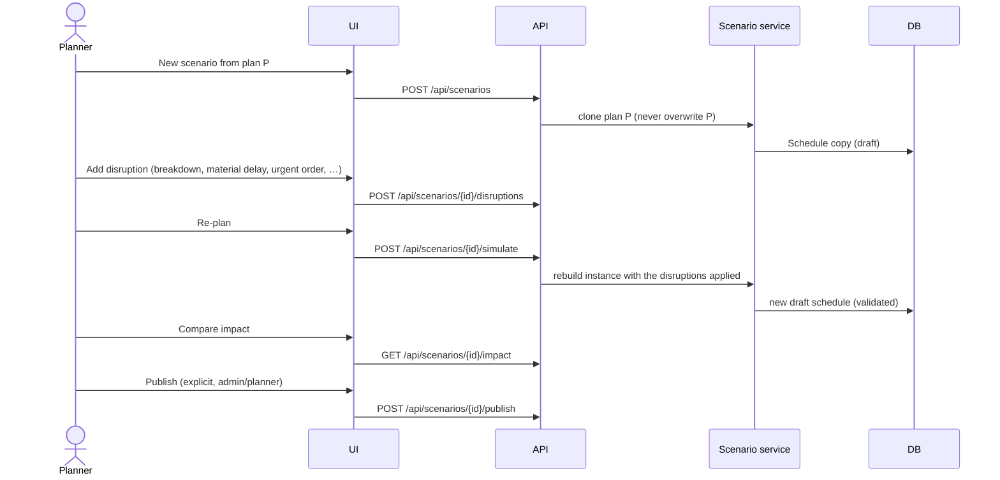
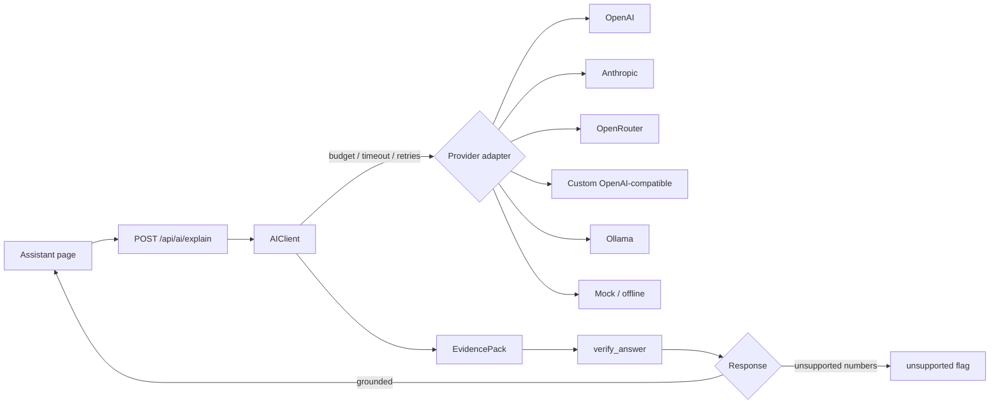
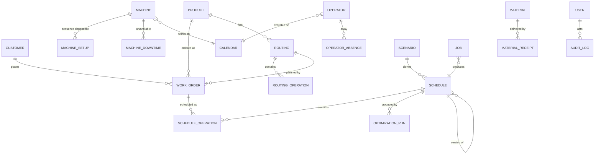

# Architecture

> Intelligent Production Scheduling AI — constraint-aware scheduling with
> OR-Tools CP-SAT, FastAPI and React.

---

## 1. The one rule that shapes the whole system

> **The constraint solvers decide. The AI only explains.**

The scheduling engine (FCFS baseline + CP-SAT optimiser) and the *independent*
validator own every scheduling decision. The AI subsystem receives a read-only
`EvidencePack` that was derived from an already validated schedule and may only
describe it. Numbers that are not present in the evidence are flagged as
`unsupported` instead of being silently presented as facts.



---

## 2. Component map

| Layer | Package | Responsibility |
| --- | --- | --- |
| Domain | `app/domain/` | Integer-minute time algebra, DST-aware calendar engine (shifts, breaks, holidays, windowed shutdowns, machine exceptions). Pure functions, no I/O. |
| Scheduling | `app/scheduling/` | `instance` (data model), `builder` (DB → instance), `fcfs` (baseline), `cpsat` (optimiser), `postprocess` (setup gaps), `validator` (independent audit), `metrics` (measurement + comparison). |
| Services | `app/services/` | `scheduling_service` (run / persist / publish / compare), `scenarios` (clone → disrupt → re-plan → publish), `auth` (JWT + RBAC), `audit` (immutable log). |
| AI | `app/ai/` | `providers` (six adapters), `grounding` (EvidencePack + numeric verification), `client` (budget, retries, timeouts, disabled mode). |
| HTTP | `app/api/` | 74 REST operations under `/api`, Pydantic v2 schemas, dependency-injected session and current user. |
| Persistence | `app/models/` | SQLAlchemy 2.0 ORM, Alembic migrations, `UTCDateTime` decorator. |
| Frontend | `frontend/src/` | Ten screens, SVG Gantt renderer, TanStack Query, axios client with a token store. |

---

## 3. The scheduling pipeline



Both engines receive **the same** `SchedulingInstance` and enforce **the same**
hard constraints. The FCFS plan is handed to CP-SAT as a warm start
(`CpSatOptions.hint_assignments` → `add_hint()`), which usually saves the
optimiser a large part of its search time.

### The planning reference

A plan is only reproducible when the instant it is planned *for* is
reproducible. The platform therefore has a single notion of "now"
(`app.config.planning_now()`):

* by default it is the current wall-clock time, so a demo always shows the
  current date;
* when `PLANNING_REFERENCE` is configured (or `--reference` is passed to the
  CLI) it is a fixed instant, and the demo factory, the planning horizon **and**
  the disruption events all use it.

The published benchmarks use the fixed reference `2024-05-13T00:00:00Z`
(a Monday, so the plant calendar and the Sunday plant shutdown of the demo
factory line up exactly as documented). The CLI prints the reference it used
and writes it to the raw JSON, so a reader can tell which instance produced a
number.

---

## 4. Hard constraints

Every hard constraint is enforced by the solvers **and** re-checked by the
independent validator, which shares no code with the solvers. The validator
exposes the audit trail as `H1 … H14` codes.

| Code | Constraint | Where it is enforced |
| --- | --- | --- |
| H1 | Machine eligibility (type, capability, product family) | `builder` (eligible set) + `cpsat` (machine literals) |
| H2 | Machine capacity — no overlapping operations | per-machine `AddNoOverlap` + FCFS slot scan |
| H3 | Machine working calendar (shifts, breaks, holidays, shutdowns, breakdowns) | start domain restricted to working windows; downtime removes windows |
| H4 | Sequence dependent setup gaps between time-consecutive operations | setup chain (`AddCircuit` style successor literals) |
| H5 | Operator qualification (skills / certifications) | eligible operator set per task/machine |
| H6 | Operator machine eligibility | eligible operator set per task/machine |
| H7 | Operator availability and no double booking | operator intervals + per-operator `AddNoOverlap` |
| H8 | Material availability (time-phased inventory) | cumulative constraint at every receipt boundary |
| H9 | Release dates | `start ≥ release` |
| H10 | Routing precedence including transfer times | predecessor → successor with transfer gap |
| H11 | Mandatory (hard) deadlines | `end ≤ hard_deadline` |
| H12 | Locked operations keep their committed slot | machine literal pinned, start/end pinned |
| H13 | Operation duration / indivisibility | `end == start + duration` (no splitting) |
| H14 | Planning horizon | start/end inside the horizon |

### Time model

* All computation uses **integer minutes**; no floating point times.
* The database stores UTC; plant local time is only used while expanding the
  calendar (`zoneinfo`, DST aware).
* `calendar_mode="containment"` is the only implemented mode: an operation must
  fit *inside* working windows. "Stretch" mode is deliberately **not**
  implemented and is documented as a limitation.

---

## 5. The CP-SAT model



Details worth knowing:

* **Machine choice** — one boolean literal per (task, machine) pair with
  `Σ literals == 1`. The machine's own start variable carries a *union domain*
  of its legal start instants, so the calendar constraint is enforced by the
  domain rather than by big-M constraints.
* **Operator choice** — one boolean literal per (task, operator) pair, with
  `crew_size` operators selected and pairwise distinctness for crews. When the
  operator's availability covers the machine's windows (the common case: both
  use the plant calendar), the *task* start variable is reused for the operator
  interval instead of creating a second union-domain variable. This keeps the
  model roughly 1 000 variables smaller on the large demo dataset.
* **Setup times** — for every machine a successor chain over the ordered
  candidate pairs. `first`/`last` literals enforce exactly one Hamiltonian
  path, and `start[b] ≥ end[a] + setup(fa, fb)` realises the gap. When a
  machine has more than `chain_limit_per_machine` (60) candidates the model
  falls back to pairwise disjunctions and the setup objective term is disabled
  (a diagnostic is emitted — the status is never silently changed).
* **Batch routing** — an optional routing `batch_size` determines the number
  of internal batches (`ceil(order quantity / batch_size)`). Inter-batch
  changeover minutes (`batch_setup_minutes`) are added to the task's contiguous
  machine duration. The task remains indivisible to the scheduler; the UI
  exposes batch size, inter-batch changeover and the resulting operation.
* **Alternatives / parallel routes** — preferred machine IDs and
  `allow_alternative_machines` control eligibility; operations sharing a
  routing parallel-group label may run concurrently. Routing transfer times
  are enforced between predecessor / successor groups.
* **Material availability** — for every material and every receipt boundary
  `T`: `Σ_t qty_t · [start_t ≤ T] ≤ available(T)`. Quantities are scaled to
  integers (×1000) and rounded *down* so the constraint never rejects a
  schedule the real inventory allows.
* **Objective** — a weighted sum of normalised terms: weighted tardiness,
  makespan, setup, overtime, flow (WIP) and schedule stability. Presets are
  exposed by `GET /api/scheduling/objectives`.
* **Warm start** — the FCFS baseline is handed to the optimiser as a *complete*
  hint: the machine and operator literals, the operator start variables, the
  task start variables, the inventory "already started" literals and the setup
  chain of every machine (successor arcs, `first`/`last` flags and the "machine
  used" flag). A partial hint would force CP-SAT to complete it itself, which
  on the 280-operation dataset costs more time than the entire search.
* **Presolve tuning** — CP-SAT's *probing* presolve (level 2 by default) tries
  to detect dominated variables. On the sequencing models of this platform it
  costs several seconds and delays the first incumbent far enough that a
  time-limited run can end without **any** solution. It is therefore switched
  off automatically for models with more than 20 000 variables
  (`CpSatOptions.probing_level` overrides this). Small models keep the stronger
  and cheap presolve.
* **Reproducibility** — `random_seed` is fixed by default (42) and `workers` is
  limited. In addition to the wall-clock limit the solver accepts a
  *deterministic* budget (`CpSatOptions.deterministic_time_limit`), which
  counts the solver's internal work instead of elapsed time. With a
  deterministic budget the solver performs the same search on every machine, so
  the published benchmark results are reproducible independently of the host's
  speed.
* **Cancellation** — `CpSatOptions.cancel_check` is polled by a solution
  callback; on cancel the search stops and the best feasible solution found so
  far is returned with the status `CANCELLED`.

### Solver status semantics

| Status | Meaning |
| --- | --- |
| `OPTIMAL` | The solver proved optimality for the model it solved. |
| `FEASIBLE` | A valid plan was found; **no** optimality claim is made. |
| `PARTIAL` | Some operations could not be scheduled (insufficient capacity). |
| `INFEASIBLE` | The model has no solution. |
| `UNKNOWN` | The time limit expired before any solution was found. |
| `CANCELLED` | The operator cancelled the run; the best solution so far is kept. |

---

## 6. The FCFS baseline

The baseline is not a toy: it honours *exactly* the same hard constraints, so
the comparison with the optimiser is meaningful.

* Work orders are ordered by `(priority desc, release_at asc, due_at asc,
  work_order_code asc)` — a documented, deterministic priority with a total
  tie-break.
* For every operation the baseline scans the **joint** machine × operator slot
  space for the earliest feasible start, honouring machine windows, operator
  windows, material availability, release dates, hard deadlines, precedence and
  transfer times.
* The result is always re-validated by the same independent validator; if the
  baseline cannot satisfy the constraints it reports `PARTIAL`/`INFEASIBLE`
  honestly instead of publishing a broken plan.

---

## 7. Independent validator

`app/scheduling/validator.py` re-derives every hard constraint from the
`SchedulingInstance` and the produced assignments. It imports **nothing** from
`fcfs.py` or `cpsat.py`, so a bug that affects both solvers cannot hide. The
validation report is attached to every schedule, returned by the API and
displayed in the UI.

---

## 8. Scenarios (what-if)



* Eight disruption kinds: `machine_breakdown`, `material_delay`,
  `operator_absence`, `maintenance_window`, `urgent_order`, `order_cancelled`,
  `quantity_change`, `demand_surge`.
* The live schedule is **never** modified implicitly. Publishing is an
  explicit, audited action.
* Completed and locked work is preserved; the plan change is measured with
  the *schedule stability* metrics (`displaced_operations`, `moved_operations`,
  `schedule_disruption_pct`).

---

## 9. Concurrency, jobs and limits

| Concern | Mechanism |
| --- | --- |
| Long running runs | `POST /api/jobs` — the job row is committed first, the worker thread then re-reads it in its **own** session. |
| Cancellation | `POST /api/jobs/{id}/cancel` sets `cancel_requested`; the worker polls it and the solver callback stops the search. |
| Concurrent optimisations | `ConcurrencyGuard` (limit from `MAX_CONCURRENT_OPTIMIZATIONS`). Interactive runs answer **HTTP 429**, background jobs wait up to 600 s for a slot. |
| Rate limiting | Per-client sliding window middleware (`RATE_LIMIT_REQUESTS` / `RATE_LIMIT_WINDOW_SECONDS`). |
| Health | `GET /api/health` (liveness) and `GET /api/ready` (database reachable). |
| Audit | Every privileged action is written to an append-only `audit_log`. |

---

## 10. The AI subsystem



* Six provider kinds behind one small interface — adding a provider is a
  single adapter class.
* API keys are stored **encrypted at rest** in the database, are never
  returned by the API and never reach the browser.
* `AI_ENABLED=false` disables the subsystem completely; the deterministic
  `mock` provider keeps the UI and the tests fully functional offline.
* See [`docs/ai.md`](ai.md) for the provider guide.

---

## 11. Frontend

* React 18 + TypeScript (strict) + Vite 6 + Tailwind 3 + TanStack Query.
* The browser only ever calls the same origin (`/api`), which Vite proxies to
  the backend in development and nginx proxies to the API container in
  production. No CORS configuration is needed in production and no secret can
  leak into the bundle.
* The Gantt chart is a dependency-free SVG renderer with grouping, zoom
  levels, setup windows, locked/late states, tooltips and filters.
* Component tests (Vitest + Testing Library) and end-to-end tests (Playwright)
  drive the real application.

---

## 12. Data model



---

## 13. Repository layout

```
backend/
  app/
    domain/        time + calendar algebra (pure)
    scheduling/    instance, builder, fcfs, cpsat, postprocess, validator, metrics
    services/      scheduling_service, scenarios, auth, audit
    ai/            providers, grounding, client
    api/           routes, deps, schemas
    models/        SQLAlchemy ORM
    seed/          deterministic demo factory
  alembic/         migrations
  tests/           unit, property, API, scenario, concurrency and benchmark tests
frontend/
  src/pages/       ten application screens
  src/components/  shared UI + Gantt renderer
  e2e/             Playwright end-to-end tests
  scripts/         screenshot capture
docs/              architecture, API, AI, benchmarks, images
scripts/           setup and start helpers (bash + PowerShell)
```
